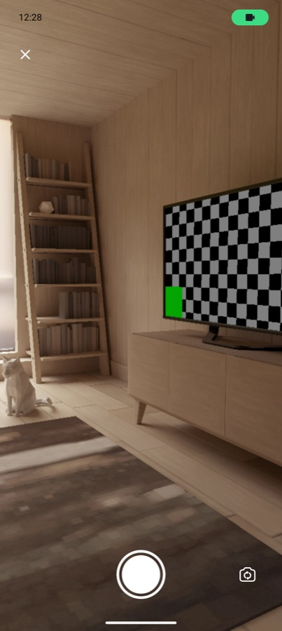
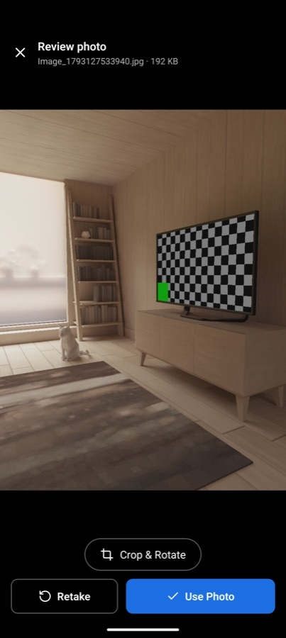
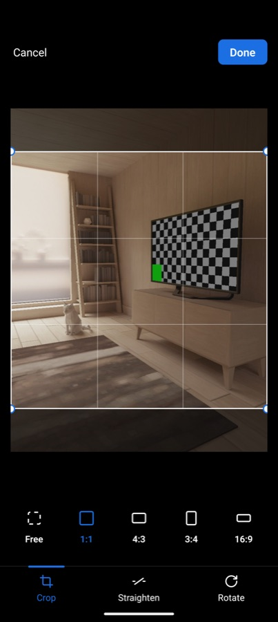
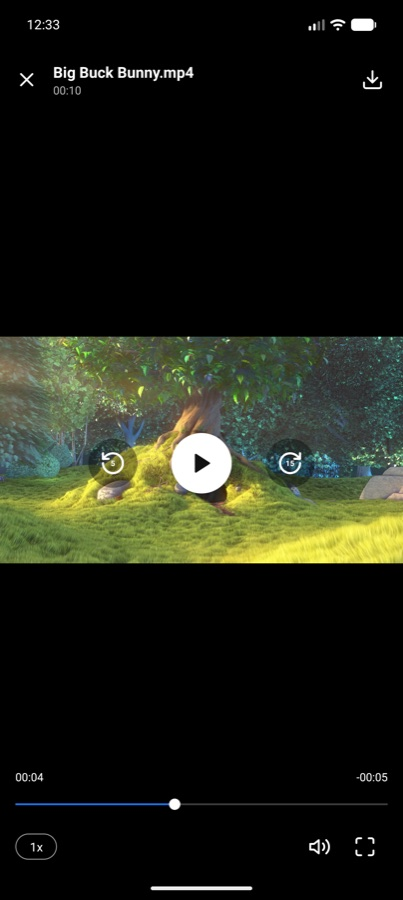

# react-native-document-kit

Camera, photo library, document picker, downloads, saving and in-app preview for
React Native, in one package with one result shape.

[](https://www.npmjs.com/package/react-native-document-kit)
[](https://www.npmjs.com/package/react-native-document-kit)
[](https://github.com/PremRockz/react-native-document-kit/blob/main/LICENSE)

[](https://appetize.io/app/b_grlhwnmqijfqcq4kxve2kg3n6i)
[](https://github.com/PremRockz/react-native-document-kit/releases/latest/download/react-native-document-kit-demo.apk)
[](https://premrockz.github.io/react-native-document-kit/)

<details>
<summary>📲 <b>Test on a real Android phone</b> (scan the QR code)</summary>
<br />


1. Scan the code with your phone's camera, or open the
   [direct APK link](https://github.com/PremRockz/react-native-document-kit/releases/latest/download/react-native-document-kit-demo.apk).
2. Open the downloaded file. If Android asks, allow your browser to install unknown apps.
3. Open **DocumentKit Playground**. The real camera, picker, downloads and preview all work.

The APK is built from [`example/`](example/) by a GitHub Action on every release.
</details>

🤖 **Android:** ready · 🍎 **iOS:** ready · ⚡ **New Architecture** · 📄 **MIT**

<p align="center">
  
  
  
  
</p>
<p align="center"><sub>Camera · Review · Crop &amp; Rotate · Video player</sub></p>

## ✨ Features

| | Feature | What you get |
|---|---|---|
| 📸 | **In-app camera** | Photo and video in one screen: pinch zoom, 0.5× / 1× / 2× lenses, tap to focus, flash, front/back, pause/resume, multi-capture |
| 📱 | **System camera** | The phone's own camera app as a fallback |
| 🖼️ | **Photo library** | System photo picker, photos and/or videos, single or multiple, no permission needed |
| 📂 | **Document picker** | Files, Google Drive, iCloud… filtered by type, original names kept |
| ⬇️ | **Downloads** | Cached, retried and resumed, with progress, cancel and a notification |
| 💾 | **Save to device** | `Download/` folder on Android (no permission), Save to Files on iOS |
| 👀 | **In-app preview** | PDF, images, text, CSV and HTML; video and audio streamed |
| 🎨 | **Theming & text** | Every colour, the font and every label can be changed |

## 🚀 Why use it

- 📦 **No extra packages.** Only `react` and `react-native`. Nothing else to install or link, and no version clashes with other camera or picker libraries.
- ⚡ **Fast.** The camera starts while the permission prompt is still open, and a file downloaded once opens instantly next time.
- 🛡️ **Never throws.** Every call resolves a result with a `status`. Cancelled, denied and busy are normal outcomes, so no `try`/`catch`.
- 🧩 **One result shape.** The camera, the library and the document picker all return the same file object, so your upload code doesn't care where it came from.
- 📶 **Built for slow networks.** Video quality follows the connection, downloads retry and resume, and video and audio stream instead of downloading first.
- 👆 **Double-tap safe.** If a screen is already open, a second call returns `busy` instead of stacking screens.
- 🗂️ **Files that stay.** Every returned file is a copy in your app's cache, still readable after the picker closes, ready for uploads and retries.
- 🔐 **Expired sessions handled.** On a 401/403, `onUnauthorized` asks you for fresh headers and retries once.
- 🏗️ **New Architecture native.** TurboModules and a Fabric camera view: Kotlin with CameraX and Media3 on Android, Objective-C++ on iOS.

## 📦 Install

```sh
npm install react-native-document-kit
cd ios && pod install
```

Needs React Native 0.79 or later with the New Architecture, iOS 15+, and Android
`minSdkVersion` 29 with `compileSdkVersion` 36. Rebuild the app after installing.
iOS also needs camera and microphone keys in `Info.plist` (see the docs).

### Expo

Works with a **development build** (`npx expo prebuild`, `npx expo run:android` or
EAS Build), not in **Expo Go** or Snack, because it has its own native code. Use
Expo SDK 53 or later (New Architecture).

```sh
npx expo install react-native-document-kit
```

Then add the config plugin to `app.json`:

```json
{
  "expo": {
    "plugins": [
      ["react-native-document-kit", {
        "cameraPermission": "Take photos and videos to attach.",
        "microphonePermission": "Record sound with your videos."
      }]
    ]
  }
}
```

The plugin adds the iOS camera and microphone texts and raises Android
`minSdkVersion` to 29 (and `compileSdkVersion` to 36 where Expo's default is lower).
Both texts are optional. Pass `"microphonePermission": false` to leave the
microphone out; videos then record without sound.

The [Expo test app](https://github.com/PremRockz/react-native-document-kit/tree/main/expo-example)
shows the setup and has a button for every feature.

## ⚡ Quick start

```tsx
import {DocumentKitProvider, useDocumentKit} from 'react-native-document-kit';

// 1. Once, near the root of your app
export const App = () => (
  <DocumentKitProvider>
    <Root />
  </DocumentKitProvider>
);

// 2. Anywhere below it
const AttachPhoto = () => {
  const {capturePhoto} = useDocumentKit();

  const attach = async () => {
    const result = await capturePhoto();
    if (result.status === 'picked') {
      await upload(result.files[0]); // {uri, name, mimeType, size, ...}
    }
  };

  return <Button title="Take photo" onPress={attach} />;
};
```

## 📖 Documentation

The **[documentation site](https://premrockz.github.io/react-native-document-kit/)**
covers the whole API, permissions, theming, translations, expired sessions
(401/403), recipes and troubleshooting. It's also on GitHub as
[one Markdown file](https://github.com/PremRockz/react-native-document-kit/blob/main/docs/GUIDE.md).

## 🤝 Contributing and issues

Found a bug or have an idea? [Open an issue](https://github.com/PremRockz/react-native-document-kit/issues).
Expo reports are especially welcome. Pull requests are welcome too; the
[Playground app](https://github.com/PremRockz/react-native-document-kit/tree/main/example)
is the quickest way to try a change.

## 📄 License

MIT

## ❤️ Support

If you like the package, please support it: give the repo a star and
**[subscribe on YouTube](https://www.youtube.com/channel/UCY1m2KQz71Hd3SvQE4lqsow)**. ❤️
